<!-- README.md is generated from README.Rmd. Please edit that file -->

# annoCyt

<!-- badges: start -->

<!-- badges: end -->

The goal of annoCyt is to provide users with an enhanced capability for
annotating high-dimensional cytometry data. For ease, an end-to-end
pipeline is provided within the package (clustering, annotating and
dimension reduction).

Currently, many workflows require cells to be clustered to a low number
of dimensions to make manual annotation feasible. However, granularity
is lost with this approach. Therefore, annoCyt allows annotation on a
large number of clusters by removing some of the manual steps required
in this process.

In the annotation step, users are required to input two tables: - a
lineage table which details the hierarchical lineage of cell types they
want to discover and the markers that compose each cell type; - and a
rules table which details how each cell type should be called, based on
the rules allowed by the algorithm.

The annotation step works on two metrics that can be generated within
the package: 
* scaled median expression per cluster
* likelihood scores per cell type and per cluster. These scores are generated for every cell
type listed in the lineage table with at least one positive marker (ie
if a cell type is defined as only having negative markers, then this
score will NOT be generated). Each score represents how likely a cluster
is to be a specific cell type, based on the expression of markers listed
as composing that cell type in the lineage table. This is based on the
expectation that markers for a certain cell type will be enriched in the
cluster compared to markers for other cell types (eg, CD19 will have
high expression in B cells, while low expression of CD3 and CD56).
Enrichment scores are generated by the singscore package.

The annotation step in annoCyt is modelled off how biologists typically
annotate manually. Therefore, there is much flexibility in how the
annotation is performed and is *not* unbiased. The goal of annoCyt is to
provide a systematic approach to annotating high-dimensional cytometry to
allow for robust downstream analyses and consistent comparisons.

Clustering functions are mostly wrappers around CATALYST functions.

For a full breakdown on how to construct the lineage and rules table,
scroll to the bottom.

## Installation

You can install the development version of annoCyt like so:

``` r
# install.packages("devtools")
devtools::install_github("neeson-lab/annoCyt")
```

## Workflow Example

This is a basic example which shows you how to run annoCyt using CyTOF data of healthy human PBMCs (one sample).

``` r
library(annoCyt)
```
Create a sample metadata sheet with the required columns: file_name; sample_id; patient_id: run_id

``` r
sample.annot
#>              file_name sample_id condition patient_id run_id
#> 1 /path/to/sample1.fcs   sample1   control        pt1  run_1
```

We need to know the marker that each channel corresponds to. Create a table to define the channel-marker mapping. This can be done manually (eg in Excel and import in), or you can try create the table with this function. Supply the sample metadata sheet and the format that the channel and marker appears in your fcs file (which is ultimately based on how you set it up on the cytometry machine). You can choose to remove markers/channels you want to ignore. Read the function help page for more information.

``` r
# Creates a table that maps each channel to marker.
cm.map = createChannelMarkerTable(sample.annot, format = "channel_marker", rm.markers = c("Cisplatin", "DNA1", "DNA2", "FVS"))
```

Now let's create the objects to store all the data and cluster the cells. The cofactor value will depend on the cytometry method chosen (5 is typical for CyTOF, >= 3000 for Cytek).

``` r
# Create a flowSet which contains all fcs files
 global.fset = createFlowset(sample.annot, cm.map)

# Create a SingleCellExperiment object
 sce = createSCE(cm.map,sample.annot,global.fset, cofactor.val = 5)

# Cluster cells with CATALYST
sce = CATALYST::cluster(sce, features = "type", xdim = 10, ydim = 10, maxK = 80, verbose = FALSE, seed = 1234)
```

We can create some plots to run some QC checks.

``` r
# QC plot to check number of cells per sample
CATALYST::plotCounts(sce, color_by = "sample_id") + ggplot2::theme(legend.title = ggplot2::element_blank())
```

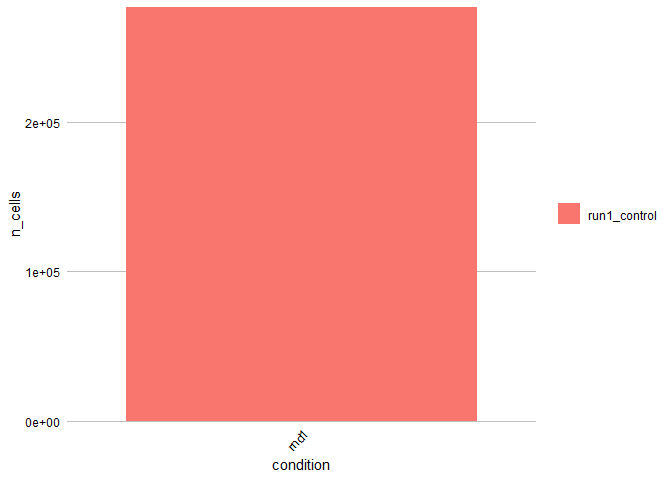

``` r

# QC plot to check if cofactor value is appropriate.
CATALYST::plotExprs(sce, color_by = "condition")
```

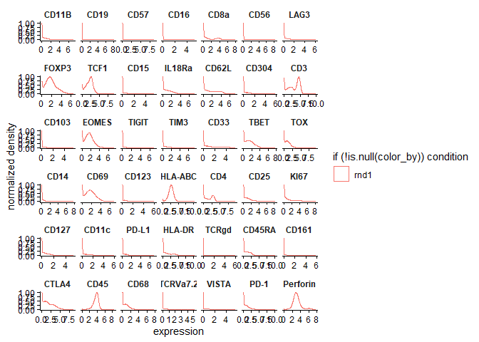

``` r
# Heatmap of clusters
CATALYST::plotExprHeatmap(sce,  by="cluster_id", k = "som100", col_clust = FALSE, distance="euclidean",
                row_anno=F, bars = T, perc = T)
```

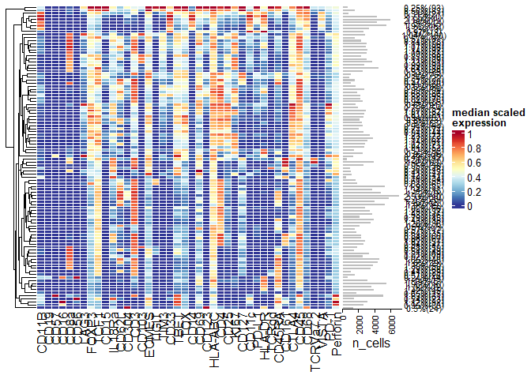

To run the annotation, we first need to generate expression values per marker and cluster and likelihood scores per cluster and per cell type (scroll to the bottom for more information on this). The lineage table and rules table should have been created externally (eg in Excel) so will need to be read in. We can also check they have valid syntax. 

``` r
# Get scaled median expression of each marker per cluster
df.expr = scaleClusterExpr(sce)

# Get singscore likelihood scores of each cell type per cluster
df.scores = generateScores(lineagedf = lineage.table, exprdf = df.expr)

# Read in lineage table and rules table

# check the lineage table has all valid syntax
checkLineageTable(lineage.table, df.expr)

# check the rules table has all valid syntax
checkRulesTable(rulesdf = rules.table,
                lineagedf = lineage.table,
                exprdf = df.expr)

# Visualise the hierarchy of your cell types with a basic tree diagram!
annoDiagram(lineage.table)
```

Now we can run the annotation! We need to specify the scores we generated, our cell type hierarchy and rules tables. You can choose which clusters we want to annotate if you wish. The output is a table specifying the annotation label for each cluster.

If you are running into errors or the annotation is not working as expected, setting verbose = TRUE can give some indication of how the annotation is working at each level of the hierarchy and the pass/fail status of each rule being called. Warning - it is a VERY long output if you are annotating all (100) clusters! Set which.clusters to specific clusters for a more focused output.

``` r
# Run annotation on each cluster. Works on all clusters present in df.expr and df.scores. Set verbose = TRUE if want a long and detailed description of how each cluster is being annotated.
df.anno = annotateClusters(
  expression_data = df.expr,
  ranking_scores = df.scores,
  rulesdf = rules.table,
  lineagedf = lineage.table,
  which_clusters = "all",
  verbose = F
)
```

Add the annotation labels into the SCE object so each cell and cluster will be associated with the label.

``` r
# Add df.anno into SCE object
sce = annoToSCE(sceobj = sce, cluster_annotation_df = df.anno, anno_name = "ct2", overwrite = T)
```

Having the right rules and thresholds may require a few iterations of
annotating. Here are some plots that may assist with setting thresholds
etc.

``` r
# Plot heatmap of clusters with cluster id and annotation label attached
plotClusterHeatmap(sceobj = sce, lineage_df = eg_lineageTable,  anno_name = "ct2",output_matrix = F)
```

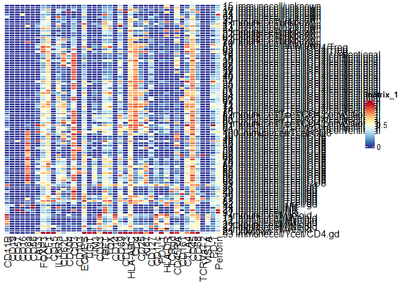

``` r
# Plot expression and singscore values per cluster. Output is a list of plots (or png if desired)
expr.plots = plotClusterValues(cluster_values_df = df.expr, cluster_annotation_df = df.anno, as.image = F)
singscore.plots = plotClusterValues(cluster_values_df = df.scores, as.image = F)
```

``` r
# PLot singscore values of multiple cell types across clusters to compare
plotSiblings(
  ranking_scores_df  = eg_singscores,
  compare.labels = c("Tcell", "NK"),
  cluster_annotation_df  = eg_annoTbl,
  all.clusters = F
)
```

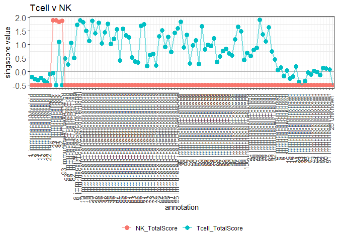

Users may also want to run a form of lineage-independent annotation;
i.e., check if certain markers have positive or negative expression in
each cluster. There is no hierarchy associated with this type of annotation - it is purely to look individual marker expression in each cluster.

``` r
# Create a named list of marker and threshold value
expr.thresh = c(KI67 = 0.5)

# Get dataframe comparing marker expression per cluster to threshold.
marker.presence = compareToThreshold(scores_matrix = df.expr, 
                                       threshold_matrix = expr.thresh)
```

    #>   cluster_id  KI67
    #> 1          1 KI67-
    #> 2          2 KI67-
    #> 3          3 KI67-
    #> 4          4 KI67+
    #> 5          5 KI67-
    #> 6          6 KI67-

Now that annotation is complete, we may want to extract counts for each cell type in each sample and compare across conditions. There are two ways to extract this information - per CLUSTER or per LABEL. To generate counts per label, we MUST get counts per cluster first. 

``` r
# Get counts of number of cells per cluster per sample. Optional to include lineage independent annotation in this as well.
cluster.counts = getCountsPerCluster(sce, thr_clusters_df = marker.presence, cluster_code = "som100", anno_name = "ct2")
```

    #> # A tibble: 6 × 9
    #> # Groups:   sample_id, annotation [1]
    #>   sample_id    cluster_id annotation label1 label2 label3 label4 n_cluster KI67 
    #>   <fct>        <chr>      <fct>      <chr>  <chr>  <chr>  <chr>      <int> <chr>
    #> 1 run1_control 1          immunecel… immun… Myelo… <NA>   <NA>        4283 KI67-
    #> 2 run1_control 2          immunecel… immun… Myelo… <NA>   <NA>        4339 KI67-
    #> 3 run1_control 3          immunecel… immun… Myelo… <NA>   <NA>        2699 KI67-
    #> 4 run1_control 11         immunecel… immun… Myelo… <NA>   <NA>        5917 KI67-
    #> 5 run1_control 12         immunecel… immun… Myelo… <NA>   <NA>        5470 KI67-
    #> 6 run1_control 13         immunecel… immun… Myelo… <NA>   <NA>        3312 KI67-

``` r
# Get count of number of cells PER LABEL per sample. This adds the counts of clusters with the same label together per sample.
label.counts = getCountsPerLabel(cluster.counts)
```

    #> # A tibble: 6 × 14
    #> # Groups:   sample_id [1]
    #>   sample_id    annotation label1 label2 label3 label4 n_label1 n_label2 n_label3
    #>   <fct>        <fct>      <chr>  <chr>  <chr>  <chr>     <dbl>    <dbl>    <dbl>
    #> 1 run1_control immunecel… immun… Myelo… <NA>   <NA>     275168    26968       NA
    #> 2 run1_control immunecel… immun… NK     <NA>   <NA>     275168    10319       NA
    #> 3 run1_control immunecel… immun… Tcell  CD4.gd <NA>     275168   192226      685
    #> 4 run1_control immunecel… immun… Tcell  CD4    conve…   275168   192226   112185
    #> 5 run1_control immunecel… immun… Tcell  CD4    Treg     275168   192226   112185
    #> 6 run1_control immunecel… immun… Tcell  CD8    <NA>     275168   192226    67466
    #> # ℹ 5 more variables: n_label4 <dbl>, p_label1 <dbl>, p_label2 <dbl>,
    #> #   p_label3 <dbl>, p_label4 <dbl>

Cell types listed in the lineage table may not be present in certain
samples or at all. Knowing that they have a 0-count is often useful for
differential abundance testing. Therefore, we can add these missing cell
types in to the cluster counts dataframe and rerun getCountsPerLabel to
see these cell types.

``` r
# Add missing cell types to cluster.counts dataframe and then rerun getCountsPerLabel().
cluster.counts.all = addMissing(cluster_counts = cluster.counts, cluster_annotation_df  = df.anno, lineagedf = lineage.table)

label.counts.all = getCountsPerLabel(cluster.counts.all)
```

Then we can run differential abundance testing with ggplot2 (not shown).
Functions for differential abundance testing may be added in due time..

``` r
# Run dimension reduction
sce = CATALYST::runDR(sce, dr = "UMAP", cells = 500)

# Plot DR via CATALYST...
CATALYST::plotDR(sce, color_by = "ct2") 

#... or output the DR coordinates so can do whatever (plot with ggplot2, etc)
umapdata = getDRdata(sce, df.anno, anno_name = "ct2" )
```

Users may run the above steps per batch of data to further increase
granularity. If so, we provide a function to combine multiple SCE
objects for dimension reduction purposes. Expression is scaled per
cluster per batch, then downsamples per sample, then dimension reduction
is run and finally output into a dataframe with sample and marker level
information.

``` r
# Combined dimension reduction across multiple SCEs.
umapDataComb = combineBatchDR(input.list = list(sce), n_cells_per_sample = 5000, dr_method = "UMAP", cluster_code = "som100")
```

## How to Construct the Lineage Table and Rules Table

### Step 1: Define cell types you want to find

To annotate with annoCyt, think about what cell types and subtypes you
want to find. It would be helpful to draw a tree diagram (like a family
tree!) that defines the cell type lineage. This will become the
annotation logic.

<figure>
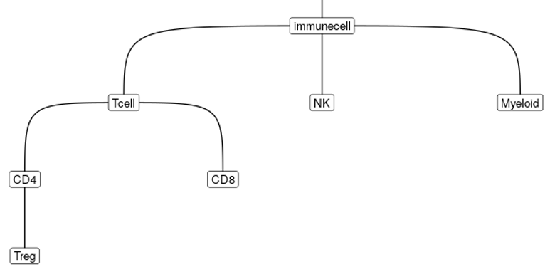
</figure>

### Step 2: Define the markers for each cell type

The logic behind annoCyt is the same as in the tree diagram. For
example, first it will check if a cluster is an immune cell. If a
cluster is an immune cell, then it will check if it is a T cell or an NK
cell or a Myeloid. For it to know what an immune cell is, we have to
define which markers make up that cell type.

Note: For annoCyt, avoid thinking about markers that are not absolutely
necessary to define a cell type (eg exhaustion markers, immune
checkpoints etc). When there are many cell types or subtypes that
express the same markers, it will not work very well. These additional
markers can help confirm if the annotation is correct but it is best not
to include them right now (they can be included/used later!)

For example: 
* Immune cell: CD45+ 
* T cell: CD3+ 
* NK: CD56+ CD3- 
Note that while T cells and NKs are CD45+, we don’t need to specify
CD45 explicitly because they are a subtype of immune cells.

### Step 3: Define the rules for how to call each cell type

Based on the marker definition above, we know which markers define a
cell type. But how positive or negative do they need to be, and how can
we compare across clusters? We need to tell annoCyt how to recognise a
cell type (based on the markers that define it, the marker’s expression,
which markers are most highly expressed in the cluster, etc). That is,
we need to define the rules for how to call each cell type.

Here is an explanation of the possible rules: 
* If expression of relevant markers is higher/lower in a cluster compared to other clusters
  * Some clusters will have high CD56, while others will have low
CD56. We can use this logic to find NK cells 
  * Note: We use the scaled expression values to compare expression across clusters. We will
also set a threshold to demarcate high and low expression. This is
similar to drawing the box when gating.  
* If expression of relevant markers is more extreme compared to
other markers in the same cluster 
  * Eg, a cluster with high levels
of CD56 but low levels of CD3 is probably an NK cell 
  * To determine
what markers are high and low within a cluster, we use a scoring method
called ‘singscore’. Singscore ranks the expression of every marker
within a cluster. After we define which markers are important for each
cell type, it will use the ranking to generate a likelihood score that
represents how likely a cluster is to be a certain cell type. 
  * We will also need to set a threshold for the singscore to demarcate high
and low scores. 0 is the lowest recommended threshold. We will generate
a singscore “score” for almost every cell type you’re interested in,
plus some special cases. 
* Similarly, there may multiple possible subtypes that a cluster could be (eg, once we have determined something
is a T cell, it could then be a CD4 or CD8 T cell). We can check the CD4
singscore and CD8 score to see which one is higher. In annoCyt, I’ve
called this process finding the “max”
* If a cluster is not defined
as one cell type, then it is probably another cell type (as long as it
also expresses certain markers) 
  * Eg: a cluster may be a Myeloid cell if it is NOT an NK, T or B cell Here is an updated tree diagram of
the markers (BLUE) and rules (RED) we could use to define each cell
type. As you get more familiar with annoCyt, you will get more
comfortable with deciding which rules are relevant to use for your data
set. When some markers work well but others do not, certain rules may be
more appropriate than others.

<figure>
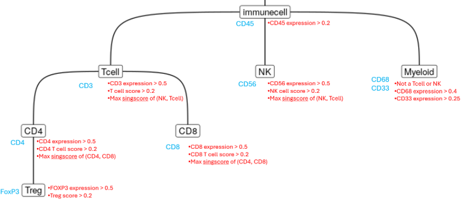
</figure>

#### Step 4: Create Excel table or dataframes

##### Lineage table

The first file describes the cell type lineage. Basically, you want to
convert your tree diagram into an Excel table. Each row in the table
will give information about one cell type. The first column provides the
label for the cell type. The second column tells what the parent of that
cell type is (eg, per the tree diagram, the parent of a Tcell is an
immune cell. The parent of a CD4 is a Tcell.) The third column describes
which markers make up that cell type. Below is an example.

<figure>
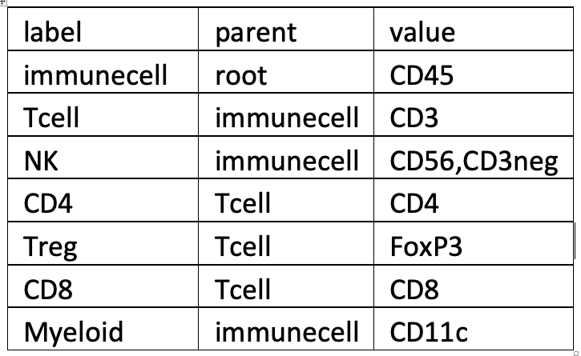
</figure>

Important checks: 
* Your columns must be called “label”, “parent” and “value” 
* Do NOT include any full stops or spaces in the label
or parent column – use an underscore instead if necessary
* In the value column, separate your markers with a comma
* For the very first cell type (which is “immunecell” in the diagrams above), put
“root” in the parent column.
* If you have markers that a cell type is negative for (eg NKs are CD3-), include these in “value”. Indicate
they are negative by writing “neg” after the marker without any spaces
(eg CD3neg)
* If all the markers that make up a cell type are
negative markers, you can include them in your lineage table but a
singscore value will NOT be generated for it. (You can still create
rules for identifying these cell types by using a “not.” rule)
* The capitalisation/spelling/punctuation of your markers in the third column
MUST BE THE SAME as how the markers are written in your .fcs files
* DO NOT use spaces in the label or parent column.

##### Rules table

Each row describes one rule for a cell type. A cell type is allowed to
have many rules, with each rule written in a separate row. The first
column indicates the cell type (must have the same
spelling/capitalization/punctuation as the “label” column in your first
file). The second column indicates the rule– note there is only one rule
per row. The third column specifies the threshold (if relevant). If a
threshold isn’t relevant, write “NA”. Here is the nomenclature rules for
the “rule” column: 
* e.greaterthan: check if expression is greater
than a certain threshold (must specify a number in the threshold
column). Note it is inclusive of the threshold value (i.e., greater than
or equal to), unless the threshold is 0 or less
* e.lessthan: check if expression is lower than a certain threshold (must specify a number
in the threshold column). Not inclusive of the threshold value unless it
is 0 or less 
* NOTE ON E.GREATERTHAN AND E.LESSTHAN
  * If only
one marker makes up a cell type, then you can just write e.greatherthan
  * If multiple markers make up a cell type, and you want to threshold
each marker differently, you must specify the marker before the “e.”
part by writing eg “CD3e.greaterthan”
  * If multiple markers make up
a cell type and they all have the same threshold, you can just write
“e.greaterthan”
* s.greaterthan: check if singscore is greater than
a certain threshold (must specify a number in the threshold column).
Inclusive of the threshold value, unless the threshold is 0
* max(label1,label2) : compares the singscore of all the cell types
listed in the brackets and checks that the desired cell type has the
highest score out of all of them.
* not. : check if the cluster is
not a certain cell type. The part after the full stop must be one of the
other labels 
* isct. : check if the cluster is a certain cell type.
The part after the full stop must be one of the other labels

Here is an example:

<figure>
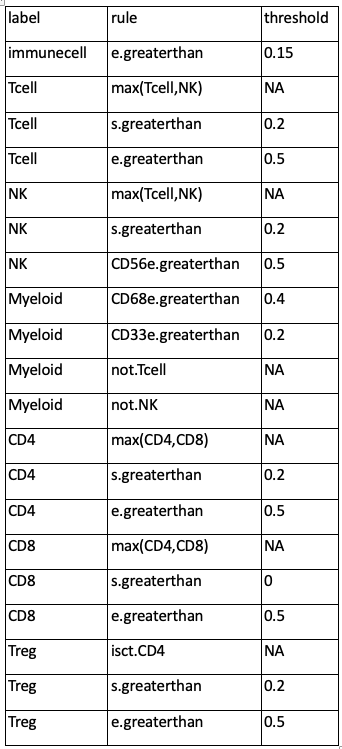
</figure>

##### When to use certain rules? Some recommendations:

* Include a max threshold when there are multiple subtypes that are
possible
* Including a singscore threshold of at least 0 is
recommended for most, if not all, cell types
* Including an expression threshold (as well as a singscore threshold) is useful to
have to add a layer of protection. Sometimes the expression threshold
works better (or worse) than the singscore method – it ultimately
depends on how well the markers worked.
* If there is only one possible label at a particular level, include a “not.” rule. This way
you can distinguish between clusters that actually aren’t that
particular label, and those that are “unknown” (ie, don’t pass any
rules). For example, when you want to find clusters which are
“expanding” based on Ki67, any clusters that are don’t meet the rules
will be labelled “unknown”. But non-expanding clusters are different to
unknown-expanding clusters. So include a “nonexpanding” label using the
rule “not.expanding”

Special cases A singscore score will be generated for every cell type
listed in your lineage table based on the markers you specified.
However, there are some circumstances where you may want to generate a
singscore for certain subsets of markers (rather than including all the
markers of a cell type in one score).

For example, in another dataset, we realised that creating a
Naïve/CM/EM/TEMRA score using CCR7 and CD45RA together was not ideal.
Therefore, we created a score for just CCR7 and just CD45RA, and set
separate thresholds for each. We decided to do this because the
expression of one marker was generally much higher across all clusters,
and so was affecting the score such that it was not informative.

If you want to create a score for certain markers, but not explicitly
include it in your cell type lineage, you can create a row in the
lineage table as such:

<figure>
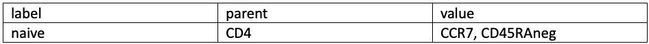
</figure>

By writing “special” in the parent column, it will not be a part of the
lineage directly, but it will generate a singscore score for that label,
which you can then include in your rules table.

Please still include a row in your lineage table with the full set of
markers you used to define a cell type. Eg:

<figure>
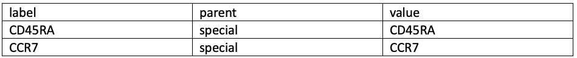
</figure>
